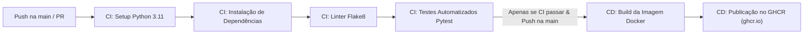

# 🚛 OBD2 - Telemetria Veicular & API REST

[](https://github.com/Lucas-Cayres-Porto/OBD2/actions/workflows/ci-cd.yml)

Sistema moderno de telemetria automotiva via protocolo OBD2 com ingestão de dados em tempo real, desenvolvido em Python e **FastAPI**, com pipeline completa de **CI/CD no GitHub Actions** e implantação contínua em contêineres Docker no **GitHub Container Registry (GHCR)**.

---

## 🎯 Objetivo do Projeto
Permitir a captura, validação e persistência de dados de telemetria de frotas de caminhões e veículos pesados, disponibilizando:
- Autenticação e identificação de motoristas.
- Vinculação e seleção de veículos da frota.
- Ingestão contínua de parâmetros críticos do motor (RPM, temperatura de admissão, arrefecimento, posição do acelerador, pressão do coletor, combustível e sensores de O2).
- Documentação interativa OpenAPI/Swagger UI.

---

## 🏗️ Arquitetura do Projeto

```text
OBD2/
├── app/
│   ├── __init__.py
│   ├── main.py            # Instância FastAPI, documentação e healthcheck
│   ├── config.py          # Configurações e variáveis de ambiente
│   ├── schemas.py         # Schemas e validações com Pydantic v2
│   ├── database.py        # Camada de dados e repositórios
│   └── routes/
│       ├── auth.py        # Endpoints de autenticação de motoristas
│       ├── veiculos.py    # Listagem de veículos da frota
│       └── telemetria.py  # Ingestão de leituras OBD2
├── tests/
│   ├── test_health.py     # Testes de status e healthcheck
│   ├── test_auth.py       # Testes de validação de login e e-mail
│   ├── test_telemetria.py # Testes de payload de telemetria
│   └── test_cores.py      # Testes do utilitário de cores ANSI
├── .github/
│   └── workflows/
│       └── ci-cd.yml      # Pipeline CI (pytest/flake8) e CD (Docker/GHCR)
├── Dockerfile             # Imagem de contêiner de produção
├── .dockerignore
├── requirements.txt       # Dependências da aplicação
├── coletaDadosOBD2.py     # Script legado de leitura OBD2
└── cores.py               # Utilitário de formatação de console
```

---

## ⚙️ Pipeline de CI/CD (GitHub Actions)

A pipeline é acionada automaticamente a cada `push` ou `pull_request` para a branch `main`:



1. **Continuous Integration (CI)**:
   - Configuração do runtime Python 3.11 com cache de dependências.
   - Instalação dos pacotes via `pip`.
   - Análise estática e verificação de sintaxe via `flake8`.
   - Execução da suíte de testes com `pytest -v`.
2. **Continuous Deployment (CD)**:
   - Só é executado se todas as etapas da CI forem aprovadas.
   - Realiza o build multiplataforma da imagem Docker.
   - Publica a imagem no **GitHub Container Registry (GHCR)**:
     `ghcr.io/lucas-cayres-porto/obd2:latest`

---

## 🚀 Como Executar Localmente

### 1. Clonar o repositório e criar ambiente virtual
```bash
git clone https://github.com/Lucas-Cayres-Porto/OBD2.git
cd OBD2
python -m venv .venv
# No Windows:
.venv\Scripts\activate
# No Linux/Mac:
source .venv/bin/activate
```

### 2. Instalar dependências
```bash
pip install -r requirements.txt
```

### 3. Rodar os testes
```bash
pytest -v
```

### 4. Iniciar o servidor FastAPI
```bash
uvicorn app.main:app --reload --port 8000
```
Acesse a documentação interativa em: [http://localhost:8000/docs](http://localhost:8000/docs)

---

## 🐳 Executando via Docker

```bash
# Executando a imagem publicada no GHCR:
docker run -p 8000:8000 ghcr.io/lucas-cayres-porto/obd2:latest
```
