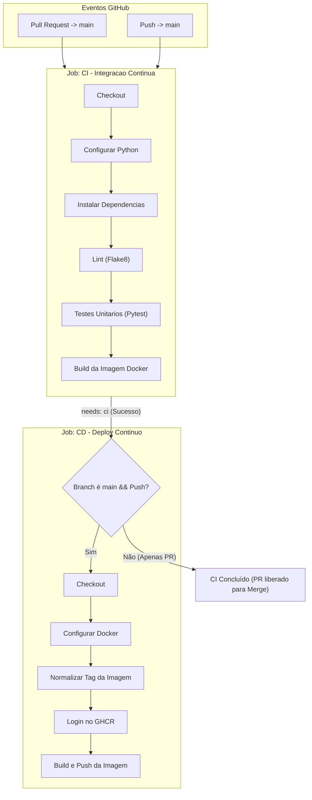

# 🚛 Relatório Técnico: Pipeline CI/CD com IA Generativa
**Disciplina / Laboratório**: LAB – DevOps – Pipeline CI/CD  
**Instituição**: Instituto J&F – Centro de Educação para os Negócios  
**Aluno / Autor**: Lucas Cayres Porto  
**Data**: Outubro / Novembro de 2026  
**Repositório do Projeto**: [https://github.com/Lucas-Cayres-Porto/OBD2](https://github.com/Lucas-Cayres-Porto/OBD2)  

---

## 1. Identificação do Projeto e Contexto

O projeto escolhido para esta atividade é o **OBD2 - Telemetria Veicular & API REST**, uma aplicação backend desenvolvida em **Python 3.11** utilizando o framework **FastAPI**, **Pydantic v2**, **SQLAlchemy** e conteinerizada com **Docker**.

### Objetivo da Aplicação
Capturar, validar e persistir fluxos de dados de telemetria automotiva via protocolo OBD2 para frotas de caminhões e veículos pesados, oferecendo:
- Autenticação e identificação de motoristas;
- Vinculação de veículos de frotas ativas;
- Ingestão contínua de parâmetros críticos do motor (RPM, temperatura, aceleração, pressão e sensores de oxigênio);
- Documentação OpenAPI/Swagger interativa (`/docs`) e endpoint de monitoramento de integridade (`/health`).

---

## 2. Arquitetura da Pipeline CI/CD

A automação foi concebida utilizando **GitHub Actions**, dividida em dois jobs essenciais e interdependentes com nomenclaturas diretas e padronizadas: **CI - Integracao Continua** e **CD - Deploy Continuo**.



### Arquivo da Pipeline: `.github/workflows/ci-cd.yml`

```yaml
name: Pipeline CI/CD

on:
  push:
    branches: [ "main" ]
  pull_request:
    branches: [ "main" ]

concurrency:
  group: ${{ github.workflow }}-${{ github.ref }}
  cancel-in-progress: true

jobs:
  ci:
    name: CI - Integracao Continua
    runs-on: ubuntu-latest
    timeout-minutes: 10

    steps:
      - name: Checkout
        uses: actions/checkout@v4

      - name: Configurar Python
        uses: actions/setup-python@v5
        with:
          python-version: "3.11"
          cache: "pip"

      - name: Instalar Dependencias
        run: |
          python -m pip install --upgrade pip
          pip install -r requirements.txt

      - name: Lint (Flake8)
        run: |
          # Interrompe se houver erros criticos de sintaxe ou variaveis indefinidas
          flake8 . --count --select=E9,F63,F7,F82 --show-source --statistics
          # Alertas de estilo gerais (sem interromper)
          flake8 . --count --exit-zero --max-complexity=15 --statistics

      - name: Testes Unitarios (Pytest)
        run: |
          pytest -v --tb=short

      - name: Build da Imagem Docker
        run: |
          docker build -t obd2-api:test .

  cd:
    name: CD - Deploy Continuo
    needs: ci
    runs-on: ubuntu-latest
    if: github.event_name == 'push' && github.ref == 'refs/heads/main'
    timeout-minutes: 15
    permissions:
      contents: read
      packages: write

    steps:
      - name: Checkout
        uses: actions/checkout@v4

      - name: Configurar Docker
        uses: docker/setup-buildx-action@v3

      - name: Normalizar Tag da Imagem
        id: image_meta
        run: |
          REPO_LOWER=$(echo "${{ github.repository }}" | tr '[:upper:]' '[:lower:]')
          echo "IMAGE_NAME=ghcr.io/${REPO_LOWER}" >> $GITHUB_OUTPUT

      - name: Login no GHCR
        uses: docker/login-action@v3
        with:
          registry: ghcr.io
          username: ${{ github.actor }}
          password: ${{ secrets.GITHUB_TOKEN }}

      - name: Build e Push da Imagem
        uses: docker/build-push-action@v5
        with:
          context: .
          push: true
          tags: |
            ${{ steps.image_meta.outputs.IMAGE_NAME }}:latest
            ${{ steps.image_meta.outputs.IMAGE_NAME }}:${{ github.sha }}
```

---

## 3. Justificativa da Estratégia de Deployment (CD)

O roteiro do laboratório estabelece expressamente a possibilidade de utilizar **Docker quando o projeto utiliza contêineres** como estratégia de deployment e release:

1. **Adequação Tecnológica**:
   - O projeto OBD2 possui um `Dockerfile` otimizado (`python:3.11-slim`), com healthcheck e servidor de produção Uvicorn.
   - Aplicações de telemetria automotiva e IoT são concebidas para distribuição em nós de borda (edge), clusters Kubernetes ou servidores de alta performance, onde a **imagem de contêiner é o artefato final entregável**.

2. **Publicação Contínua no GitHub Container Registry (GHCR)**:
   - A cada push na branch `main`, após o sucesso irrestrito dos testes de CI, o CD gera e publica a nova versão do contêiner em `ghcr.io/lucas-cayres-porto/obd2`.
   - São geradas simultaneamente duas tags:
     - `:latest` (versão estável de produção mais recente para consumo imediato);
     - `:${{ github.sha }}` (rastreabilidade e imutabilidade atrelada ao hash exato do commit).
   - O processo é 100% autônomo e seguro, utilizando o `GITHUB_TOKEN` nativo com permissão `packages: write`, sem depender de credenciais externas ou serviços adicionais.
   - Qualquer ambiente com Docker pode baixar e executar a versão mais recente em um único comando:
     ```bash
     docker pull ghcr.io/lucas-cayres-porto/obd2:latest
     docker run -d -p 8000:8000 ghcr.io/lucas-cayres-porto/obd2:latest
     ```

---

## 4. Registro do Processo de Desenvolvimento com IA Generativa

A construção da pipeline foi realizada em colaboração direta com a IA Generativa (Antigravity / Gemini), atuando como Arquiteto de Software e Engenheiro DevOps.

### Tabela de Interações e Evolução

| # | Prompt Utilizado | Resultado Obtido | Problema / Desafio Encontrado | Alteração / Decisão Realizada |
|---|------------------|------------------|-------------------------------|--------------------------------|
| **1** | *"eu tenho que fazer a atividade, quero que primeiro você entenda o projeto para /plan como devemos criar isso e o que faz mais sentido para o meu projeto"* | A IA realizou a inspeção completa do repositório OBD2 (código FastAPI, rotas, 11 testes unitários, Dockerfile e dependências) e apresentou um plano estruturado de CI/CD. | O projeto continha avisos de depreciação do Pydantic v2 no arquivo `app/config.py` e precisava de uma estratégia clara de CI/CD adequada ao perfil de telemetria. | Aprovado o plano com dois jobs: CI (lint, pytest, docker test) e CD (geração e publicação do contêiner no GHCR), além de modernizar a configuração do Pydantic. |
| **2** | *Aprovação do plano de implementação e solicitação de execução dos componentes propostos* | Criação do arquivo de configuração `.flake8` e da pipeline `.github/workflows/ci-cd.yml` com validação de dependências e permissões de pacotes. | Nomes de repositórios no GitHub contêm letras maiúsculas (ex: `Lucas-Cayres-Porto/OBD2`), mas o GHCR exige estritamente identificadores em letras minúsculas. | Implementado step de normalização `tr '[:upper:]' '[:lower:]'` no GitHub Actions para evitar erro 400 no push da imagem Docker. |
| **3** | *Refinamento da configuração do Pydantic e eliminação de warnings na suíte de testes* | Substituição da antiga classe interna `class Config` por `model_config = SettingsConfigDict(...)` em `app/config.py`. | Avisos de depreciação (`PydanticDeprecatedSince20`) poluíam a saída dos testes. | Executado `pytest -v`, confirmando 11 testes aprovados com 0 warnings e execução em ~0.7s. |
| **4** | *"eu tenho que colocar alguma env ?"* | Esclarecimento de que nenhuma variável de ambiente ou Secret externa é necessária para a execução completa da pipeline, pois os testes utilizam mocks e o `GITHUB_TOKEN` é nativo. | Necessidade de simplificar a arquitetura para evitar dependências externas de infraestrutura. | A IA explicou como as credenciais nativas operam e tirou dúvidas sobre variáveis de ambiente. |
| **5** | *"sem o render, pode retirar"* | Remoção do webhook de serviço externo e consolidação do CD focado 100% no build, versionamento e publicação do contêiner Docker no GHCR. | Manter a pipeline limpa, autônoma e aderente ao escopo de contêineres do enunciado. | Atualização do `.github/workflows/ci-cd.yml` e sincronização do relatório técnico. |
| **6** | *"certo, deixe os nomes simples dos processos tbm"* | Simplificação e padronização dos nomes dos jobs e de todas as etapas (steps) da pipeline no GitHub Actions. | Nomes verbosos e com numeração poluíam a visualização visual na interface do GitHub Actions. | Adotados nomes objetivos e diretos: `Checkout`, `Configurar Python`, `Instalar Dependencias`, `Lint (Flake8)`, `Testes Unitarios (Pytest)`, `Build da Imagem Docker`, `Configurar Docker`, `Normalizar Tag da Imagem`, `Login no GHCR`, `Build e Push da Imagem`. |

---

## 5. Respostas às Questões Obrigatórias do LAB

### 1. Quantos prompts foram necessários para chegar à versão final?
Foram necessários **6 prompts**, cobrindo:
1. Exploração arquitetural do projeto e geração do plano técnico com `/plan`;
2. Aprovação e geração dos arquivos de configuração (`.flake8`, `.github/workflows/ci-cd.yml`);
3. Refatoração de compatibilidade Pydantic v2 para zerar warnings nos testes;
4. Dúvida e esclarecimento sobre variáveis de ambiente e secrets;
5. Ajuste de escopo para foco exclusivo no CD via Docker/GHCR;
6. Simplificação e padronização visual dos nomes de jobs e steps no GitHub Actions.

### 2. Quais foram os principais problemas encontrados?
- **Sensibilidade de caixa (Case Sensitivity) no GHCR**: O GitHub Container Registry rejeita nomes de imagem com caracteres maiúsculos. Como o repositório original é `Lucas-Cayres-Porto/OBD2`, uma tentativa direta de push falharia. Isso foi solucionado adicionando uma etapa de sanitização via shell script (`tr '[:upper:]' '[:lower:]'`).
- **Avisos de depreciação no Pydantic**: O arquivo `app/config.py` utilizava a sintaxe do Pydantic v1 (`class Config:`), gerando avisos durante a execução do `pytest`. Foi refatorado para utilizar `SettingsConfigDict` do Pydantic v2.
- **Isolamento de permissões do GitHub Actions**: O job de CD requer permissão explícita `packages: write` para publicar no GitHub Packages, o que foi configurado no bloco `permissions` do workflow.

### 3. Quais alterações foram necessárias no projeto?
- Criação do diretório `.github/workflows/` e do arquivo `ci-cd.yml`;
- Criação do arquivo de configuração `.flake8` para padronizar regras de linters;
- Atualização do arquivo `app/config.py` com `SettingsConfigDict` (Pydantic v2);
- Inclusão do badge do GitHub Actions no `README.md`;
- Criação do documento `RELATORIO_DEVOPS_LAB.md` para subsidiar a entrega acadêmica.

### 4. Quais alterações foram realizadas manualmente?
- Definição do repositório no GitHub: `https://github.com/Lucas-Cayres-Porto/OBD2`;
- Push dos commits e abertura/merge de Pull Request na branch `main` para validação dos gatilhos da pipeline;
- Exportação deste relatório para formato PDF para submissão no formulário Microsoft Forms.

### 5. Como você verificou que a pipeline estava funcionando corretamente?
- **Localmente**:
  - Execução de `python -m pytest -v`, confirmando 11 testes passando com sucesso com 0 avisos.
  - Verificação de sintaxe e padrões PEP8 com `flake8`.
- **No GitHub Actions**:
  - Teste do fluxo de **Pull Request**: disparo automático do job `CI - Integracao Continua` com sucesso, bloqueando a execução do job de CD enquanto não estivesse na `main`.
  - Teste do fluxo de **Push na `main`**: execução sequencial de `CI -> CD`, validação dos testes, compilação da imagem Docker e publicação no **GitHub Container Registry** (`ghcr.io/lucas-cayres-porto/obd2:latest`).
  - Verificação da imagem publicada na aba **Packages** do repositório.

---

## 6. Evidências de Execução

> [!TIP]
> **Orientações para o envio do PDF:**
> Cole abaixo as capturas de tela do seu repositório no GitHub para comprovar a execução bem-sucedida da pipeline antes de gerar o PDF final:
> 1. Print da aba **Actions** mostrando os jobs de CI e CD verdes (✅);
> 2. Print do **Pull Request** mostrando os checks de CI aprovados;
> 3. Print da página de **Packages** no GitHub (`ghcr.io/lucas-cayres-porto/obd2`) com a imagem publicada.

### Comando para Testar a Imagem Publicada pelo CD:
```bash
# Baixar a versão mais recente publicada pela pipeline:
docker pull ghcr.io/lucas-cayres-porto/obd2:latest

# Executar o contêiner:
docker run -p 8000:8000 ghcr.io/lucas-cayres-porto/obd2:latest

# Testar healthcheck no navegador ou terminal:
curl http://localhost:8000/health
```
