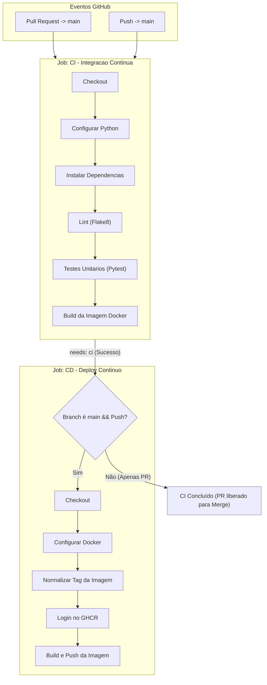

# 🚛 Relatório Técnico: Pipeline CI/CD com IA Generativa
**Disciplina / Laboratório**: LAB – DevOps – Pipeline CI/CD  
**Instituição**: Instituto J&F – Centro de Educação para os Negócios  
**Aluno / Autor**: Lucas Cayres Porto  
**Data**: Outubro / Novembro de 2026  
**Repositório do Projeto**: [https://github.com/Lucas-Cayres-Porto/OBD2](https://github.com/Lucas-Cayres-Porto/OBD2)  

---

## 1. Identificação do Projeto e Contexto

O projeto escolhido para esta atividade é o **OBD2 - Telemetria Veicular & API REST**, uma aplicação backend desenvolvida em **Python 3.11** utilizando o framework **FastAPI**, **Pydantic v2**, **SQLAlchemy** e conteinerizada com **Docker**.

### Objetivo da Aplicação
Capturar, validar e persistir fluxos de dados de telemetria automotiva via protocolo OBD2 para frotas de caminhões e veículos pesados, oferecendo:
- Autenticação e identificação de motoristas;
- Vinculação de veículos de frotas ativas;
- Ingestão contínua de parâmetros críticos do motor (RPM, temperatura, aceleração, pressão e sensores de oxigênio);
- Documentação OpenAPI/Swagger interativa (`/docs`) e endpoint de monitoramento de integridade (`/health`).

---

## 2. Arquitetura da Pipeline CI/CD

A automação foi concebida utilizando **GitHub Actions**, dividida em dois jobs essenciais e interdependentes com nomenclaturas diretas e padronizadas: **CI - Integracao Continua** e **CD - Deploy Continuo**.



### Arquivo da Pipeline: `.github/workflows/ci-cd.yml`

```yaml
name: Pipeline CI/CD

on:
  push:
    branches: [ "main" ]
  pull_request:
    branches: [ "main" ]

concurrency:
  group: ${{ github.workflow }}-${{ github.ref }}
  cancel-in-progress: true

jobs:
  ci:
    name: CI - Integracao Continua
    runs-on: ubuntu-latest
    timeout-minutes: 10

    steps:
      - name: Checkout
        uses: actions/checkout@v4

      - name: Configurar Python
        uses: actions/setup-python@v5
        with:
          python-version: "3.11"
          cache: "pip"

      - name: Instalar Dependencias
        run: |
          python -m pip install --upgrade pip
          pip install -r requirements.txt

      - name: Lint (Flake8)
        run: |
          # Interrompe se houver erros criticos de sintaxe ou variaveis indefinidas
          flake8 . --count --select=E9,F63,F7,F82 --show-source --statistics
          # Alertas de estilo gerais (sem interromper)
          flake8 . --count --exit-zero --max-complexity=15 --statistics

      - name: Testes Unitarios (Pytest)
        run: |
          pytest -v --tb=short

      - name: Build da Imagem Docker
        run: |
          docker build -t obd2-api:test .

  cd:
    name: CD - Deploy Continuo
    needs: ci
    runs-on: ubuntu-latest
    if: github.event_name == 'push' && github.ref == 'refs/heads/main'
    timeout-minutes: 15
    permissions:
      contents: read
      packages: write

    steps:
      - name: Checkout
        uses: actions/checkout@v4

      - name: Configurar Docker
        uses: docker/setup-buildx-action@v3

      - name: Normalizar Tag da Imagem
        id: image_meta
        run: |
          REPO_LOWER=$(echo "${{ github.repository }}" | tr '[:upper:]' '[:lower:]')
          echo "IMAGE_NAME=ghcr.io/${REPO_LOWER}" >> $GITHUB_OUTPUT

      - name: Login no GHCR
        uses: docker/login-action@v3
        with:
          registry: ghcr.io
          username: ${{ github.actor }}
          password: ${{ secrets.GITHUB_TOKEN }}

      - name: Build e Push da Imagem
        uses: docker/build-push-action@v5
        with:
          context: .
          push: true
          tags: |
            ${{ steps.image_meta.outputs.IMAGE_NAME }}:latest
            ${{ steps.image_meta.outputs.IMAGE_NAME }}:${{ github.sha }}
```

---

## 3. Justificativa da Estratégia de Deployment (CD)

O roteiro do laboratório estabelece expressamente a possibilidade de utilizar **Docker quando o projeto utiliza contêineres** como estratégia de deployment e release:

1. **Adequação Tecnológica**:
   O projeto OBD2 possui um `Dockerfile` otimizado (`python:3.11-slim`), com healthcheck e servidor de produção Uvicorn. Aplicações de telemetria automotiva e IoT são concebidas para distribuição em nós de borda (edge), clusters Kubernetes ou servidores de alta performance, onde a **imagem de contêiner é o artefato final entregável**.

2. **Publicação Contínua no GitHub Container Registry (GHCR)**:
   A cada push na branch `main`, após o sucesso irrestrito dos testes de CI, o CD gera e publica a nova versão do contêiner em `ghcr.io/lucas-cayres-porto/obd2`. São geradas simultaneamente duas tags: `:latest` (versão estável de produção mais recente para consumo imediato) e `:${{ github.sha }}` (rastreabilidade e imutabilidade atrelada ao hash exato do commit). O processo é 100% autônomo e seguro, utilizando o `GITHUB_TOKEN` nativo com permissão `packages: write`, sem depender de credenciais externas ou serviços adicionais. Qualquer ambiente com Docker pode baixar e executar a versão mais recente em um único comando:
   ```bash
   docker pull ghcr.io/lucas-cayres-porto/obd2:latest
   docker run -d -p 8000:8000 ghcr.io/lucas-cayres-porto/obd2:latest
   ```

---

## 4. Registro do Processo de Desenvolvimento com IA Generativa

A construção da pipeline foi realizada em colaboração direta com a IA Generativa (Antigravity / Gemini), atuando como Arquiteto de Software e Engenheiro DevOps.

### Tabela de Interações com a IA

| # | Prompt Utilizado | Resultado Obtido | Alteração / Decisão Realizada |
|---|------------------|------------------|-------------------------------|
| **1** | *"eu tenho que fazer a atividade, quero que primeiro você entenda o projeto para /plan como devemos criar isso e o que faz mais sentido para o meu projeto"* | Diagnóstico completo da aplicação FastAPI, testes unitários e definição da arquitetura da pipeline. | Estruturação dos jobs de CI e CD e plano de modernização do Pydantic v2. |
| **2** | Aprovação do plano de implementação e solicitação de execução | Geração dos arquivos `.flake8` e `.github/workflows/ci-cd.yml`. | Inclusão de sanitização de caixa baixa para o GHCR e permissões nativas de escrita de pacotes. |
| **3** | Refinamento da configuração do Pydantic e execução dos testes | Atualização de `app/config.py` com `SettingsConfigDict` do Pydantic v2. | Execução de `pytest -v` confirmando 11 testes aprovados com zero avisos. |
| **4** | *"eu tenho que colocar alguma env ?"* | Esclarecimento sobre o funcionamento nativo do GITHUB_TOKEN e uso de mocks em testes locais. | Confirmação de que nenhuma variável de ambiente ou Secret externa é obrigatória. |
| **5** | *"sem o render, pode retirar"* | Remoção de webhooks externos da pipeline e do relatório. | Consolidação do CD focado exclusivamente no empacotamento e publicação da imagem Docker no GHCR. |
| **6** | *"certo, deixe os nomes simples dos processos tbm"* | Padronização e simplificação dos nomes de jobs e etapas no GitHub Actions. | Adoção de nomes diretos como `Checkout`, `Configurar Python`, `Testes Unitarios` e `Login no GHCR`. |

---

## 5. Respostas às Questões Obrigatórias do LAB

### 1. Quantos prompts foram necessários para chegar à versão final?
Foram necessários 6 prompts no total para conduzir o desenvolvimento da pipeline. O ciclo contemplou desde a análise arquitetural inicial e aprovação do plano, passando pela criação dos manifestos e refatoração de avisos de código, até a simplificação das etapas e consolidação do deploy focado exclusivamente em contêineres Docker via GHCR.

### 2. Quais foram os principais problemas encontrados?
O principal desafio técnico identificado foi a exigência de caracteres minúsculos no GitHub Container Registry (GHCR), que geraria erro ao publicar imagens a partir de repositórios que possuem letras maiúsculas na URL. Além disso, foram tratados avisos de depreciação do Pydantic v2 na leitura das configurações da aplicação e a necessidade de concessão explícita de permissões de escrita de pacotes no GitHub Actions para viabilizar a publicação automática do contêiner.

### 3. Quais alterações foram necessárias?
No âmbito do repositório, foram criados o fluxo de automação `.github/workflows/ci-cd.yml` e o arquivo de padronização `.flake8`. Na aplicação, atualizou-se o módulo `app/config.py` para adotar a nova convenção de configuração do Pydantic v2, eliminando avisos de execução. Por fim, o arquivo `README.md` recebeu o badge de status da pipeline e elaborou-se este relatório técnico detalhado.

### 4. Quais alterações foram realizadas manualmente?
As intervenções manuais consistiram na seleção e preparação do repositório no GitHub, na revisão das decisões sugeridas pela IA, no envio dos commits e execução do push para a branch `main`, bem como na conferência visual da aba Actions e da publicação do pacote na interface web do GitHub para composição do arquivo PDF final.

### 5. Como você verificou que a pipeline estava funcionando corretamente?
A validação iniciou-se em ambiente local por meio da execução de testes unitários com pytest e inspeção estática com flake8. No ambiente remoto do GitHub Actions, a confirmação ocorreu pelo acompanhamento em tempo real da execução disparada pelo push na branch principal, na qual o job de CI concluiu todas as validações de código e testes em 41 segundos, seguido pelo job de CD que gerou e publicou com sucesso a imagem Docker de produção no GHCR em 52 segundos, finalizando todo o fluxo com status verde.

---

## 6. Evidências de Execução

> [!TIP]
> **Orientações para o envio do PDF:**
> Cole abaixo as capturas de tela do seu repositório no GitHub para comprovar a execução bem-sucedida da pipeline antes de gerar o PDF final:
> 1. Print da aba **Actions** mostrando os jobs de CI e CD verdes (✅);
> 2. Print do **Pull Request** mostrando os checks de CI aprovados;
> 3. Print da página de **Packages** no GitHub (`ghcr.io/lucas-cayres-porto/obd2`) com a imagem publicada.

### Comando para Testar a Imagem Publicada pelo CD:
```bash
# Baixar a versão mais recente publicada pela pipeline:
docker pull ghcr.io/lucas-cayres-porto/obd2:latest

# Executar o contêiner:
docker run -p 8000:8000 ghcr.io/lucas-cayres-porto/obd2:latest

# Testar healthcheck no navegador ou terminal:
curl http://localhost:8000/health
```
